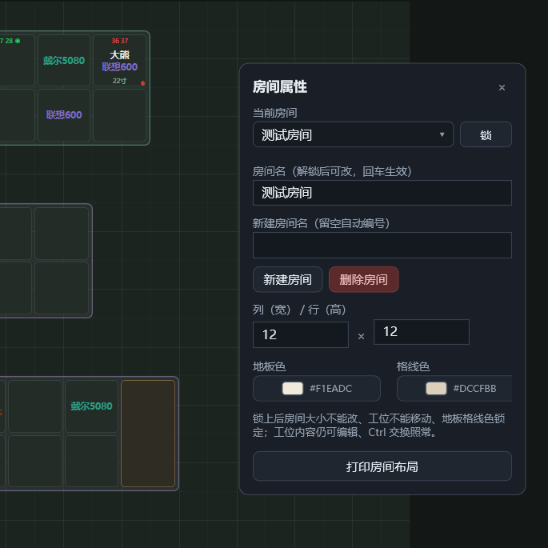
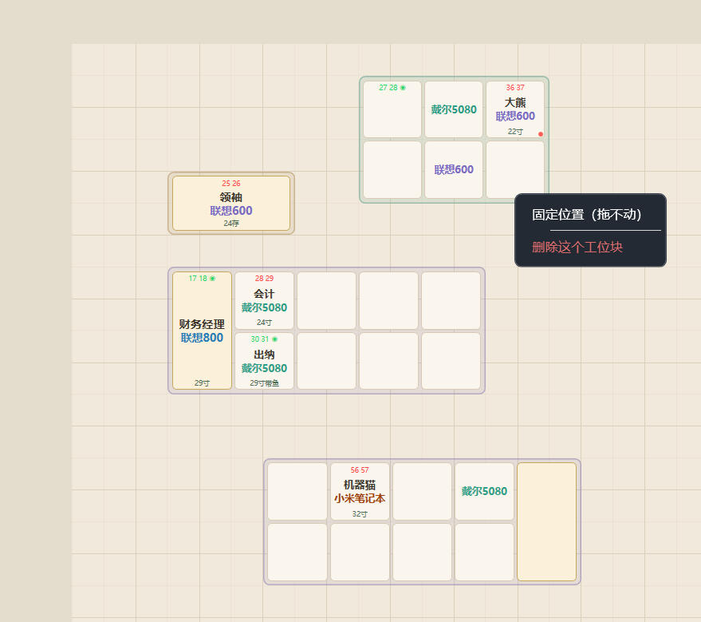

# Zogrid

**Postes · Salle serveur · Gestion des plans de salle**

Open source · Gratuit · Usage commercial autorisé · Revente interdite · 100 % hors ligne · 7 langues

**Autres langues / Other languages：**
[简体中文](README.md) · [繁體中文](README.zh-Hant.md) · [English](README.en.md) · [日本語](README.ja.md) · [한국어](README.ko.md) · [Français](README.fr.md) · [Deutsch](README.de.md)

---

Excel retient les données, mais pas *qui est assis près de la fenêtre au troisième rang*.
Les étiquettes murales indiquent les places, mais il faut les arracher à chaque mutation.

Zogrid réunit les deux : l'écran montre exactement ce qui est au mur, et chaque poste porte sa personne et ses machines.
Quelques centaines de PC dans une salle de cours, un étage entier de bureaux, un cybercafé : un seul plan suffit.

## Pour qui

**Salles informatiques scolaires** — des dizaines à des centaines de PC. Quel modèle, quelle IP, quelle machine est en panne et libre : tout se voit d'un coup d'œil.

**Étages de bureaux** — services colorés, poste de responsable sur deux cases, numéros conformes à la réalité. Changer une personne ou une machine = modifier une case.

**Cybercafés / assistance sur site** — numéros de poste, modèles, IP LAN/WAN et MAC sur un seul écran. Les places libres sont comptées en bas.

---

## Fonctions principales

### 1. Dessinez la salle telle qu'elle est

La capture ci-dessus est le panneau Propriétés de la salle : nom, colonnes et rangées, couleur du sol et de la grille.

- Nombre de salles illimité, noms libres : `3F-Salle A`, `2F-Finance`, `Cyber rez-de-chaussée`
- Colonnes et rangées au choix, couleurs réglables, thèmes clairs et sombres
- **Imprimer le plan** : imprimante système, noir et blanc, A4 portrait, mise à l'échelle automatique, en-tête avec récapitulatif des modèles
- Verrouillage de salle : le plan est figé, le contenu des postes reste modifiable

### 2. Créez vos propres blocs

- Blocs 2 places, 3 places et « avec poste chef » fournis
- Concevez les vôtres : rangées × colonnes libres, une case = un poste ; option poste chef sur deux cases
- Une couleur par bloc pour distinguer services et zones
- Réorganisez la bibliothèque par glisser-déposer

### 3. Posez-le où il faut

- Glissez un bloc dans la salle : il s'aligne sur la grille, sans saisie de coordonnées
- Placement libre : le long du mur, allée centrale, en L, en îlot
- Clic droit pour **épingler** un bloc terminé

### 4. Ctrl + glisser un poste : les personnes et les machines suivent, le numéro de port reste au mur

Ce qui pose problème lors d'une réorganisation, ce n'est pas de déplacer les personnes, mais de savoir **si le numéro de port suit**.

Règle de Zogrid : **Ctrl + glisser un poste sur un autre échange l'ensemble « personne + matériel », tandis que le numéro de port reste fixé au mur.**

| Suit la personne | Reste en place (appartient au mur) |
| --- | --- |
| Nom, matricule, modèle du PC, modèle d'écran, IP, MAC, note | Numéro de port |

Pourquoi : le numéro de port correspond au câble qui sort du mur. Les personnes changent, les machines changent, la prise ne bouge pas. Aucun rebranchement en baie, aucune correction du registre.

Détails :
- Poste chef, poste ordinaire et case vide sont interchangeables ; un mauvais geste se défait en glissant à nouveau
- **Ctrl fonctionne même salle verrouillée** (le verrou fige le plan, pas le personnel)
- La barre d'état confirme : « nom/modèle/écran/matricule/IP/MAC ont suivi, le numéro de port est resté »

### 5. Une fiche par poste

- Nom, numéro de port, modèle du PC (4 max.), modèle d'écran (souvent utilisé pour un poste téléphonique), matricule
- Cochez **Double réseau** pour enregistrer LAN et WAN avec IP et MAC distinctes
- Détails machine (IP / MAC / note) en mode Édition ou Lecture seule
- Le poste n'affiche que l'essentiel, le reste est dans la fiche

### 6. Trouvez n'importe quoi

- Recherche par nom, IP, MAC, modèle, matricule ou numéro de port, au fil de la frappe
- Les postes trouvés clignotent en rose
- Recherche, modèle et places libres sont **mutuellement exclusifs**
- Échap pour effacer

### 7. Vue d'ensemble

- Récapitulatif en bas : `4 modèles · 9 machines · 3 libres`
- Une carte par modèle avec total et places libres
- **Clic sur un modèle** : tous ses postes s'illuminent ; **clic sur libre** : seuls les postes occupés par une machine sans personne s'illuminent
- Couleur de texte propre à chaque modèle

### 8. Remplir une salle depuis un tableur

- **Données → Télécharger un modèle vierge** : 8 colonnes — Nom / Matricule / LAN-WAN / MAC / IP / Note (modèle) / Numéro de port / Modèle d'écran
- Dans une nouvelle salle, saisissez seulement les noms
- **Importer → Appliquer aux postes** remplit IP, MAC, modèle, port et écran en quelques secondes
- Une cellule vide n'écrase jamais une donnée déjà vérifiée
- **Exporter le personnel** produit le même format pour modification puis réimport

---

## À savoir aussi

- **7 langues d'interface** : 简体中文, 繁體中文, 日本語, 한국어, English, Français, Deutsch. Basculez via « Langue » dans la barre d'outils, l'application redémarre
- **Les en-têtes suivent la langue** : interface chinoise = en-têtes chinois, autres langues = en-têtes anglais, **les deux s'importent**
- **100 % hors ligne** : aucun réseau, aucune connexion, aucune collecte
- **Un seul exe** : exécutable depuis une clé USB
- **Un seul fichier de données** : `Documents\Zogrid\zogrid.json`
- **Interface sombre** adaptée aux salles serveurs
- **Guide au premier lancement** : la bibliothèque et les propriétés s'ouvrent, le bouton « Nouvelle salle » pulse

## Trois étapes

1. **Créer une salle** — F2, nom, colonnes et rangées
2. **Placer les postes** — F1, glisser les blocs, saisir les noms
3. **Charger les données** — Données → modèle vierge → Importer → Appliquer aux postes

## Raccourcis

| Touche | Action |
| --- | --- |
| F1 | Bibliothèque |
| F2 | Propriétés de la salle |
| F3 | Statistiques |
| F4 | Détails du poste |
| F5 | Tout afficher |
| Molette | Zoom |
| Clic milieu | Déplacer |
| Flèches | Déplacer de 60 px |
| **Ctrl + glisser un poste** | Échanger deux postes |
| Suppr | Supprimer le bloc |
| Échap | Effacer la recherche / fermer À propos |

## Configuration requise

- Windows 7 ou plus (Windows 10 / 11 sans rien installer)
- .NET Framework 4.0+ (inclus dans Windows 10/11)
- Aucune installation, aucun réseau, aucun droit administrateur

## Licence

**Copyright © 2026 Michael. Tous droits réservés à l'auteur.**

- **Open source et gratuit** : le code est public, consultable, compilable et utilisable librement
- **Usage commercial autorisé** : écoles, entreprises et cybercafés, gratuitement
- **Revente interdite** : aucun frais, vente, vente liée ni monétisation sous quelque forme que ce soit
- Cette restriction s'applique aussi aux versions ultérieures, aux forks et aux versions Mac ou autres plateformes
- **Sans garantie** : fourni en l'état ; l'auteur n'est pas responsable des dommages liés à son usage

Conditions complètes dans [LICENSE.txt](LICENSE.txt).

---

Auteur : Michael · Zogrid · 2026
