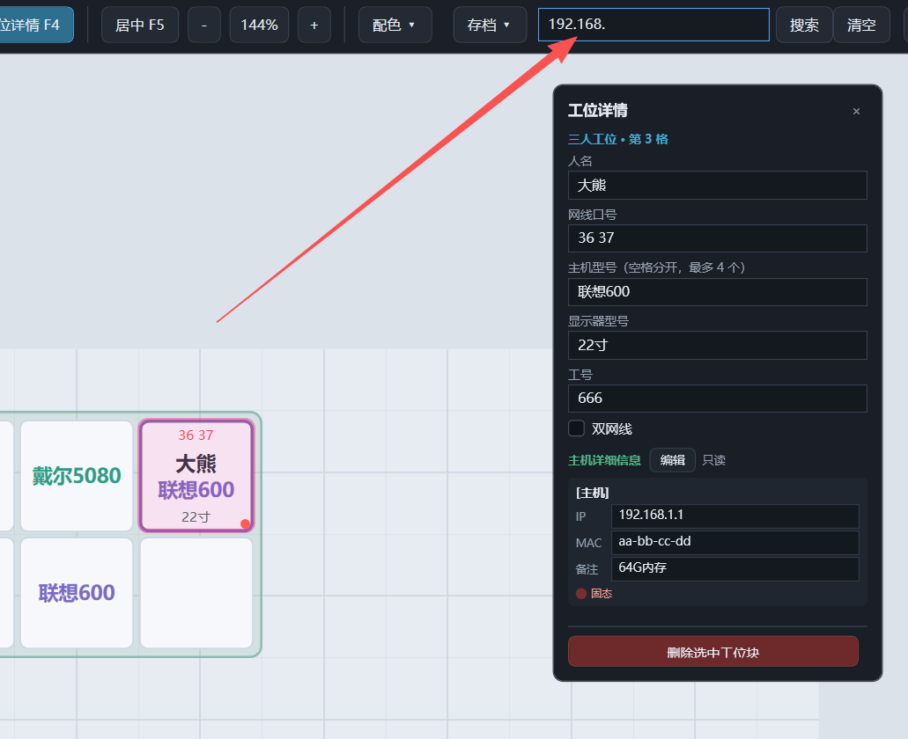

# Zogrid（ゾグリッド）

**座席 · サーバールーム · レイアウト管理**

オープンソース · 無料 · 商用利用可 · 転売禁止 · 完全オフライン · 7 言語対応

**他の言語 / Other languages：**
[简体中文](README.md) · [繁體中文](README.zh-Hant.md) · [English](README.en.md) · [日本語](README.ja.md) · [한국어](README.ko.md) · [Français](README.fr.md) · [Deutsch](README.de.md)

---

Excel はデータを覚えていても、「3 列目の窓際は誰か」は覚えていません。
壁のラベルは席を示せても、人が替わるたびに貼り直しです。

Zogrid はその二つを一つにします。画面に描いたとおりに壁へ並べ、席を開けば人と機器がそこにあります。
数百台の演習室、フロア全体のオフィス、ネットカフェの席まで、一枚の図で管理できます。

## こんな場面に

**学校の演習室** — 数十〜数百台の授業用 PC。どの席にどの機種、IP は何番、どの機械が故障して空いているかが一目で分かります。

**オフィスフロア** — 部署ごとの色分け、責任者席の 2 マス占有、実際の席番号と一致。人や機器の入れ替えは 1 マスの編集だけで済み、図を描き直す必要はありません。

**ネットカフェ / 常駐運用** — 席番号、機種、社内外 IP と MAC を一画面に。空席と残台数は下部で自動集計されます。

---

## 主な機能

### 1. 部屋は自由に描ける

上の画面が「部屋の設定」パネルです。部屋名、列と行の数、床の色、グリッド色をここで決めます。

- 部屋数は無制限。名前も自由（`3F-演習室A`、`2F-経理`、`ネットカフェ 1F`）。1 ファイルで建物全体を管理できます
- 列数・行数は自由、床とグリッドの色も変更可能。明るい配色も暗い配色も自然に見えます
- **部屋レイアウトを印刷**：システムのプリンターを使用。白黒線画、A4 縦、自動縮小して中央配置、ヘッダーに機種集計つき。印刷して壁に貼れます
- 部屋はロック可能。レイアウトは固定されますが、席の内容は編集できます（引き継ぎや監査に便利）

### 2. 席の形は自分で作る

- 2 人席、3 人席、責任者席つきを標準搭載。ドラッグするだけです
- 自分でも設計できます。行 × 列は自由、1 マス = 1 席。「責任者席あり」にすると 2 マスを占有（縦・横どちらも可）
- ブロックごとに色を設定でき、部署や区画を色で分けられます
- ライブラリ内は上下にドラッグして並べ替えできます

### 3. 置きたい場所に置く

- ライブラリから部屋へドラッグすると、グリッドに吸着します。座標入力は不要
- 壁沿い、中央に通路、L 字、島型など自由に配置できます
- 右クリックで「位置を固定」。レイアウトが崩れる心配がありません

### 4. Ctrl を押しながら席をドラッグ：人と機器がまとめて移動し、ポート番号は壁に残る

席の入れ替えで一番間違えやすいのは「人を動かすこと」ではなく、**ポート番号が人についていくかどうか**です。

Zogrid のルール：**Ctrl を押しながら席を別の席へドラッグすると、「人＋機器」がまとめて入れ替わり、ポート番号は壁に固定されたまま残ります。**

| 一緒に移動する（人に属する） | そのまま残る（壁に属する） |
| --- | --- |
| 氏名、社員番号、PC 型番、モニター型番、IP、MAC、備考 | ポート番号 |

この分け方の理由：ポート番号は壁から出ているケーブルの位置です。人が替わり機器が替わっても、その差込口は動きません。席の入れ替えでラックの差し替えも、台帳の修正も不要です。

補足：
- 責任者席、一般席、空席の間で自由にドラッグできます。間違えたら戻すだけ
- 部屋がロック中でも Ctrl 入れ替えは**使用できます**（ロックはレイアウトのみ）
- 入れ替え後はステータスバーに「氏名/型番/モニター/社員番号/IP/MAC が移動し、ポート番号は元の位置」と表示されます

### 5. 席ごとに 1 枚のカルテ

- 氏名、ポート番号、PC 型番（1 席に最大 4 台）、モニター型番（内線番号の記録に使う人も多い）、社員番号
- 「デュアルネットワーク」にチェックすると、1 席に社内・社外の 2 回線を IP と MAC 付きで記録できます
- 機器の詳細（IP / MAC / 備考）は編集と読み取り専用を切り替え可能。確認後は読み取り専用に
- 席には要点だけを表示し、詳細はカルテに収めます

### 6. 何でも検索できる

- 氏名、IP、MAC、PC 型番、社員番号、ポート番号を入力すると即座に検索
- 一致した席がピンクに点滅し、すぐ見つかります
- 検索・機種・空席のハイライトは**排他**。一つ点けると他は消えます
- Esc でクリア

### 7. 全体をひと目で

- 下部にリアルタイム集計：`4 機種 · 9 台 · 空き 3 台`
- 機種ごとにカードがあり、合計と空き数が並びます
- **機種をクリック**するとその機種の席が光り、**空きをクリック**すると「機械はあるが人がいない席」だけが光ります
- 機種ごとに文字色を設定でき、席の中の文字と対応します

### 8. 表で一気に流し込む

- 「データ → 空テンプレートをダウンロード」：氏名 / 社員番号 / 社内外 / MAC / IP / 備考（型番）/ ポート番号 / モニター型番の 8 列
- **部屋を作ったら席には氏名だけ**入力し、残りは表に書きます
- 「ブックを読み込む → 席に反映」で、氏名を手がかりに IP・MAC・型番・ポート番号・モニターを自動入力
- 空欄のセルは、部屋で確認済みのデータを上書きしません
- 「名簿を書き出す」で同じ形式に戻せるので、修正して再取り込みできます

---

## そのほか

- **7 言語対応**：簡体中文、繁體中文、日本語、한국어、English、Français、Deutsch。ツールバーの「言語」で切り替え、再起動で反映。各言語の UI 慣習に合わせた訳語です
- **列名も言語に追従**：中国語 UI は中国語の見出し、その他は英語の見出し。**どちらの表も読み込めます**
- **完全オフライン**：通信・ログイン・送信なし。情報収集も行いません
- **単一 exe**：USB メモリに入れて別の PC でも起動できます
- **データは 1 ファイル**：`ドキュメント\Zogrid\zogrid.json`。バックアップも移行もこの 1 つ
- **ダーク UI**：サーバールームの照明でも目が疲れにくい
- **初回ガイド**：設定がない場合はライブラリと部屋設定を自動で開き、「部屋を追加」が点滅します

## 3 ステップで開始

1. **部屋を作る**：F2 で部屋設定、名前と行・列を決める
2. **席を並べる**：F1 でライブラリ、ブロックをドラッグして壁どおりに配置、氏名を入力
3. **データを流す**：データ → 空テンプレートをダウンロード → 記入 → 読み込む → 席に反映

## ショートカット

| キー | 動作 |
| --- | --- |
| F1 | ブロックライブラリの表示切替 |
| F2 | 部屋設定の表示切替 |
| F3 | 機器統計の表示切替 |
| F4 | 席の詳細の表示切替 |
| F5 | 全体表示 |
| ホイール | ズーム |
| 中ボタンドラッグ | 画面移動 |
| 方向キー | 60 px ずつ移動 |
| **Ctrl + 席をドラッグ** | 2 席の内容を入れ替え |
| Delete | 選択ブロックを削除 |
| Esc | 検索クリア / 情報画面を閉じる |

## 動作環境

- Windows 7 以降（Windows 10 / 11 はそのまま動作）
- .NET Framework 4.0 以上（Win10 / Win11 は標準搭載）
- インストール不要、ネットワーク不要、管理者権限不要

## ライセンス

**Copyright © 2026 Michael. すべての権利は作者に帰属します。**

- **オープンソース・無料**：ソースコードは公開され、閲覧・ビルド・利用は自由です
- **商用利用可**：学校、企業、ネットカフェなどで無料で利用できます
- **転売禁止**：本ソフトおよび改変版を有償配布・販売・抱き合わせ販売・その他いかなる形でも収益化できません
- この制限は今後の改版、二次開発、Mac など他プラットフォーム版にも適用されます
- **免責**：現状のまま提供し、いかなる保証も行いません。使用による損害について作者は責任を負いません

詳細は [LICENSE.txt](LICENSE.txt) を参照してください。

---

作者：Michael · Zogrid · 2026
