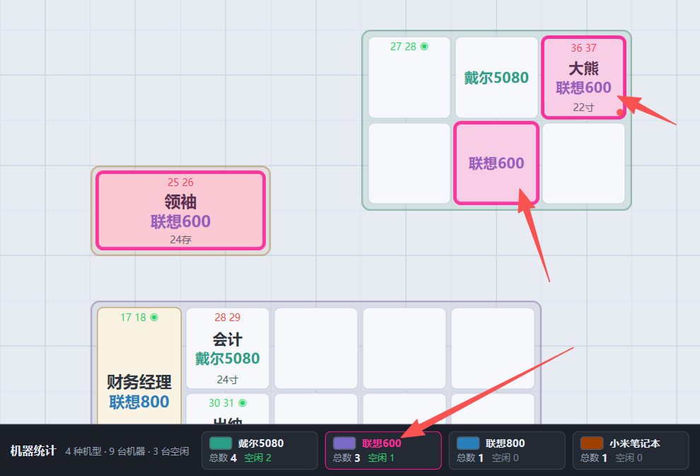

# 卓格 Zogrid

**工位 · 机房 · 座位布局管理**

开源免费 · 可商用 · 禁止售卖 · 完全离线 · 七种界面语言

**其他语言 / Other languages：**
[简体中文](README.md) · [繁體中文](README.zh-Hant.md) · [English](README.en.md) · [日本語](README.ja.md) · [한국어](README.ko.md) · [Français](README.fr.md) · [Deutsch](README.de.md)

---

Excel 记得住数据，记不住"第三排靠窗那个座位是谁"。
墙上的贴纸标得清座位，人一换就得撕下来重贴。

卓格把这两件事合成一件：屏幕上怎么画，墙上就怎么摆；点开任何一个座位，人和设备都在里面。
几百台机器的机房、整层楼的办公区、网吧的机位，一张图管完。

## 适合谁用

**院校机房**
几十上百台教学机，按班级、课程排座位。哪台机器什么型号、IP 多少、哪台坏了空着，图上一眼就能看到，不用再对着 Excel 一行行找。

**企业办公区**
部门分色、领导位跨格、工位号对得上。换人换机器只需要改一个格子，不用重画整张图。显示器、IP、MAC、网线口号全部挂在座位上，网管接手也不用问人。

**网吧 / 驻场运维**
机位编号、机器型号、内外网 IP 和 MAC 一屏看全。闲机在哪、哪个型号还剩几台，底部统计实时算好。

---

## 核心功能

### 1. 房间想怎么画就怎么画

上面那张就是房间属性面板——房间名、列宽行高、地板色、格线色都在这里定。

- 房间数量不限，名字自己起——`3F-机房A`、`2F-财务区`、`网吧一楼`，一套台账管整栋楼
- 行列数自己定，地板色、格线色随意调，浅色深色都合眼
- **打印房间布局**：直接调用系统打印机，黑白线稿、A4 竖向自动缩放居中，页眉带机型统计，打出来就能贴墙上
- 房间可上锁：锁住布局谁也动不了，工位内容仍可编辑，交班、验收时特别有用

### 2. 工位样式自己造

- 内置双人工位、三人工位、带领导位，拖出来就能用
- 也能自己设计：**排 × 列**随你定，一格就是一个工位；勾上「带领导位」，领导位自动跨格（竖占或横占都行）
- 每个工位块可以单独配色，按部门、按区域分色，一眼分区
- 库里的条目上下拖动就能调顺序，常用的排前面

### 3. 拖到哪就摆在哪

- 从左侧工位库拖进房间，落在网格上自动对齐，不用对坐标
- 工位块随便挪：靠墙排、中间留过道、L 形、岛式，怎么摆都行
- 右键可以「固定位置（拖不动）」，摆好的块锁住，不怕手滑拖歪

### 4. 按住 Ctrl 拖格子：人和机器整块搬家，网线口留在墙上

调座位最容易出错的地方不是挪人，是**网线口号到底跟不跟人走**。

卓格的规则是：**按住 Ctrl 把一个格子拖到另一个格子上，两个座位的"人+设备"整体互换，而网线口号焊在墙上不动。**

| 跟着走的（属于人） | 留在原位的（属于墙面） |
| --- | --- |
| 姓名、工号、主机型号、显示器型号、IP、MAC、备注 | 网线口号 |

为什么这样分：网线口号是墙里那根线拉出来的位置，人换了、机器换了，那个口还在原地。换个座位不用去机柜拔线重接，也不用改台账里的口号——台账和墙永远对得上。

细节：
- 领导位、普通位、空格子之间都能拖，拖错了再拖回来就行
- 房间上锁时 Ctrl 互换**照样可用**（锁的是布局，不是人员调整）
- 互换后状态栏会提示「人名/型号/显示器/工号/IP/MAC 都跟着走，网线口号留在原位」，心里有数

### 5. 一个座位一张档案卡

- 人名、网线口号、主机型号（一格最多记 4 台）、显示器型号（不少人顺手拿来记分机号或电话）、工号
- 勾上「双网线」，一个座位记内外网两条线，IP 和 MAC 各记一套
- 主机详细信息（IP / MAC / 备注）分「编辑」「只读」两档，核完数据切只读，防止手滑改错
- 格子正面只显示最关键的几行（人名、型号、显示器、网线口号），细节收在卡片里，图面不糊

### 6. 搜什么都能找

- 人名、IP、MAC、主机型号、工号、网线口号，输进去就找，边打边高亮
- 命中的工位粉色闪烁，一眼定位，不用在几百个格子里拿眼睛扫
- 搜索高亮、机型高亮、空闲高亮**三者互斥**：点亮一个，另外两个自动熄灭，图面永远干净
- Esc 一键清空，回到全局视图

### 7. 一眼看清家底

- 底部实时统计：`4 种机型 · 9 台机器 · 3 台空闲`，随时知道还剩多少余量
- 每种机型一张卡，各自写着总数和空闲数
- **点机型**：房间里这个型号的工位全部亮起；**点空闲**：只亮"有机器没人"的座位——闲机藏在哪个角落立刻现形
- 每个机型可以自定义字色，和格子里的文字一一对应，看颜色就认得出型号

### 8. 表格灌数据，几百个工位一次填完

- 「数据 → 下载空白模板」，标准 8 列：姓名 / 工号 / 内外网 / MAC地址 / IP地址 / 备注（型号/配置）/ 网线口号 / 显示器型号
- **房间建好后只需要在格子里填人名**，其余信息全写在表格里
- 「导入表格 → 同步到工位」，按人名自动把 IP、MAC、机型、网线口号、显示器型号填进对应座位，几百个工位几秒钟完成
- 表里空着的单元格不会覆盖房间里已经核好的数据，只补不擦
- 「导出人员表」把当前房间导成同样格式，改完再导回去，形成闭环

---

## 还有这些

- **七种界面语言**：简体中文、繁體中文、日本語、한국어、English、Français、Deutsch。顶栏「语言」一键切换，自动重开程序生效，界面用语按各语种习惯（不是生硬直译）
- **表格列名跟着语言走**：中文界面导出中文表头，其他语言统一用英文表头；**两种表头的表格都能导入**，中英文模板混着用也不会错列
- **完全离线**：不联网、不登录、不上传，不收集任何数据，内网机器也能用
- **单文件绿色版**：一个 exe 就能跑，扔 U 盘里换台电脑照样打开
- **数据就一个文件**：`工位存档.json`，备份、迁移、交接拷这一个就够了
- **深色界面**：机房灯光下不刺眼，长时间盯着也不累
- **首次启动有引导**：没读到配置时自动打开工位库和房间属性，「新建房间」按钮呼吸闪粉，跟着做就行
- **键盘操作**：F1–F5 开面板，F5 看全，滚轮缩放，中键拖动平移，方向键微移画布，Delete 删工位块

## 三步用起来

1. **建房间**：F2 打开房间属性，起个名字，定好行数和列数
2. **摆工位**：F1 打开工位库，把工位块拖进房间，摆成墙上的样子；格子里填上人名
3. **灌数据**：数据 → 下载模板，把全校/全公司的信息填好；导入表格 → 同步到工位，完事

## 快捷键

| 按键 | 作用 |
| --- | --- |
| F1 | 打开 / 关闭工位库 |
| F2 | 打开 / 关闭房间属性 |
| F3 | 打开 / 关闭机器统计 |
| F4 | 打开 / 关闭工位详情 |
| F5 | 看全（缩放回整张房间） |
| 滚轮 | 缩放画布 |
| 中键拖动 | 平移画布 |
| 方向键 | 平移画布（每按一次 60 像素） |
| Ctrl + 拖动格子 | 两个工位内容互换 |
| Delete | 删除选中的工位块 |
| Esc | 清空搜索 / 关闭关于窗口 |

## 系统要求

- Windows 7 及以上（Windows 10 / 11 开箱即用）
- .NET Framework 4.0 或更高（Win10 / Win11 系统自带，无需另装）
- 不需要安装，不需要联网，不需要管理员权限

## 授权

**Copyright © 2026 Michael. 一切权利归作者所有。**

- **开源免费**：源代码公开，可自由查看、编译与使用
- **可商用**：院校、企业、网吧等均可免费用于机房、工位与座位管理，包括对外经营场所
- **禁止售卖**：不得以本软件或其修改版收取任何费用、出售、捆绑销售、按次收费或以任何形式变现
- 上述限制同样适用于后续改版、二次开发，以及 Mac 等其他平台版本的开发与销售
- **免责**：本软件按「现状」提供，不附带任何明示或暗示的担保；因使用本软件造成的任何直接或间接损失，作者不承担责任

完整条款见 [LICENSE.txt](LICENSE.txt)。

---

作者：Michael　·　卓格 Zogrid　·　2026
