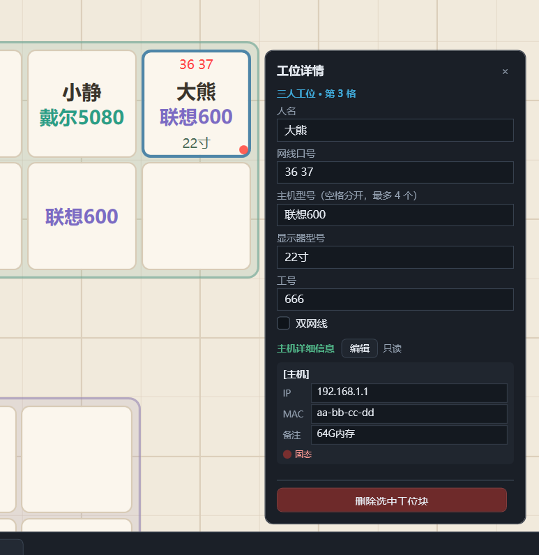

# 卓格 Zogrid

**工位 · 機房 · 座位配置管理**

開源免費 · 可商用 · 禁止販售 · 完全離線 · 七種介面語言

**其他語言 / Other languages：**
[简体中文](README.md) · [繁體中文](README.zh-Hant.md) · [English](README.en.md) · [日本語](README.ja.md) · [한국어](README.ko.md) · [Français](README.fr.md) · [Deutsch](README.de.md)

---

Excel 記得住資料，記不住「第三排靠窗那個位子是誰」。
牆上的貼紙標得清座位，人一換就得撕下來重貼。

卓格把兩件事合成一件：螢幕上怎麼畫，牆上就怎麼擺；點開任何一個座位，人與設備都在裡面。
幾百台機器的機房、整層樓的辦公區、網咖的機位，一張圖管完。

## 適合誰用

**學校電腦教室** — 幾十上百台教學機，按班級、課程排座位。哪台機器什麼型號、IP 多少、哪台壞了空著，圖上一眼就能看到。

**企業辦公區** — 部門分色、主管位跨格、工位號對得上。換人換機器只要改一個格子，不用重畫整張圖。螢幕、IP、MAC、網路孔號全掛在座位上。

**網咖 / 駐點維運** — 機位編號、機器型號、內外網 IP 與 MAC 一螢幕看全。閒置機位在哪、哪個型號還剩幾台，底部統計即時算好。

---

## 核心功能

### 1. 房間想怎麼畫就怎麼畫

上面那張就是房間屬性面板——房間名稱、欄寬列高、地板色、格線色都在這裡設定。

- 房間數量不限，名稱自己取——`3F-機房A`、`2F-財務區`、`網咖一樓`，一套檔案管整棟樓
- 欄數、列數自己定，地板色、格線色隨意調，淺色深色都合眼
- **列印房間配置**：直接呼叫系統印表機，黑白線稿、A4 直式自動縮放置中，頁首帶機型統計，印出來就能貼牆上
- 房間可上鎖：鎖住配置誰也動不了，工位內容仍可編輯，交接、驗收時特別好用

### 2. 工位樣式自己造

- 內建雙人工位、三人工位、含主管位，拖出來就能用
- 也能自己設計：**排 × 欄**隨你定，一格就是一個工位；勾選「含主管位」，主管位自動跨格（直佔或橫佔都行）
- 每個工位塊可以單獨配色，按部門、按區域分色，一眼分區
- 清單上下拖曳就能調順序，常用的排前面

### 3. 拖到哪就擺在哪

- 從左側工位庫拖進房間，落在格線上自動對齊，不用對座標
- 工位塊隨便移：靠牆排、中間留走道、L 形、島式，怎麼擺都行
- 按右鍵可以「固定位置（無法拖曳）」，擺好的塊鎖住，不怕手滑拖歪

### 4. 按住 Ctrl 拖曳格子：人與機器整塊搬，網路孔號留在牆上

調座位最容易出錯的地方不是挪人，是**網路孔號到底跟不跟人跑**。

卓格的規則：**按住 Ctrl 把一個格子拖到另一個格子上，兩個座位的「人＋設備」整體互換，而網路孔號焊在牆上不動。**

| 跟著跑的（屬於人） | 留在原位的（屬於牆面） |
| --- | --- |
| 姓名、工號、主機型號、螢幕型號、IP、MAC、備註 | 網路孔號 |

為什麼這樣分：網路孔號是牆裡那條線拉出來的位置，人換了、機器換了，那個孔還在原地。換座位不用去機櫃拔線重接，也不用改台帳裡的孔號——台帳和牆永遠對得上。

細節：
- 主管位、一般位、空格子之間都能拖，拖錯了再拖回來就好
- 房間上鎖時 Ctrl 互換**照樣可用**（鎖的是配置，不是人員調整）
- 互換後狀態列會提示「姓名/型號/螢幕/工號/IP/MAC 都跟著移動，網路孔號留在原位」

### 5. 一個座位一張檔案卡

- 姓名、網路孔號、主機型號（一格最多記 4 台）、螢幕型號（不少人拿來記分機或電話）、工號
- 勾選「雙網路線」，一個座位記內外網兩條線，IP 和 MAC 各記一套
- 主機詳細資訊（IP / MAC / 備註）分「編輯」「唯讀」兩段，核完資料切唯讀，防止手滑改錯
- 格子正面只顯示最關鍵的幾行，細節收在卡片裡，圖面不亂

### 6. 搜什麼都能找

- 姓名、IP、MAC、主機型號、工號、網路孔號，輸入就找，邊打邊標示
- 命中的工位粉色閃爍，一眼定位
- 搜尋、機型、閒置三種標示**互斥**：點亮一個，另外兩個自動熄滅
- Esc 一鍵清空

### 7. 一眼看清家底

- 底部即時統計：`4 種機型 · 9 台機器 · 3 台閒置`
- 每種機型一張卡，各自寫著總數和閒置數
- **點機型**：這個型號的工位全部亮起；**點閒置**：只亮「有機器沒人」的座位
- 每個機型可以自訂字色，和格子裡的文字一一對應

### 8. 表格灌資料，幾百個工位一次填完

- 「資料 → 下載空白範本」，標準 8 欄：姓名 / 工號 / 內外網 / MAC / IP / 備註（型號）/ 網路孔號 / 螢幕型號
- **房間建好後只要在格子裡填姓名**，其餘資訊全寫在表格裡
- 「匯入活頁簿 → 同步到工位」，依姓名自動把 IP、MAC、機型、網路孔號、螢幕型號填進對應座位
- 表裡空白的儲存格不會覆蓋房間裡已核好的資料
- 「匯出人員表」把目前房間導成同樣格式，改完再匯回去

---

## 還有這些

- **七種介面語言**：簡體中文、繁體中文、日本語、한국어、English、Français、Deutsch。頂欄「語言」一鍵切換，自動重新開啟後生效，用語依各語言習慣
- **表格欄名跟著語言走**：中文介面產生中文表頭，其他語言統一用英文表頭；**兩種表頭都能匯入**
- **完全離線**：不連網、不登入、不上傳，不收集任何資料
- **單一綠色檔**：一個 exe 就能跑，放進隨身碟換台電腦照樣開
- **資料就一個檔案**：`文件\Zogrid\zogrid.json`，備份、移轉、交接拷這一個就夠
- **深色介面**：機房燈光下不刺眼
- **首次啟動有引導**：沒讀到設定時自動展開工位庫與房間屬性，「新增房間」按鈕呼吸閃粉

## 三步用起來

1. **建房間**：F2 開房間屬性，取名稱，定好欄數與列數
2. **擺工位**：F1 開工位庫，把工位塊拖進房間，擺成牆上的樣子；格子裡填姓名
3. **灌資料**：資料 → 下載空白範本，填好全校/全公司的資訊；匯入 → 同步到工位

## 快速鍵

| 按鍵 | 作用 |
| --- | --- |
| F1 | 開 / 關工位庫 |
| F2 | 開 / 關房間屬性 |
| F3 | 開 / 關機器統計 |
| F4 | 開 / 關工位詳細資料 |
| F5 | 看全（縮放回整張房間） |
| 滾輪 | 縮放畫布 |
| 中鍵拖曳 | 平移畫布 |
| 方向鍵 | 平移畫布（每次 60 像素） |
| **Ctrl + 拖曳格子** | 兩個工位內容互換 |
| Delete | 刪除選取的工位塊 |
| Esc | 清空搜尋 / 關閉關於視窗 |

## 系統需求

- Windows 7 以上（Windows 10 / 11 開箱即用）
- .NET Framework 4.0 或更新（Win10 / Win11 內建）
- 不需安裝、不需連網、不需管理員權限

## 授權

**Copyright © 2026 Michael. 一切權利歸作者所有。**

- **開源免費**：原始碼公開，可自由檢視、編譯與使用
- **可商用**：學校、企業、網咖等均可免費用於機房、工位與座位管理
- **禁止販售**：不得以本軟體或其修改版收取任何費用、出售、搭售或任何形式變現
- 上述限制同樣適用於後續改版、二次開發，以及 Mac 等其他平台版本
- **免責**：本軟體依「現況」提供，不附帶任何擔保；使用造成的任何損失，作者不負責任

完整條款見 [LICENSE.txt](LICENSE.txt)。

---

作者：Michael · 卓格 Zogrid · 2026
